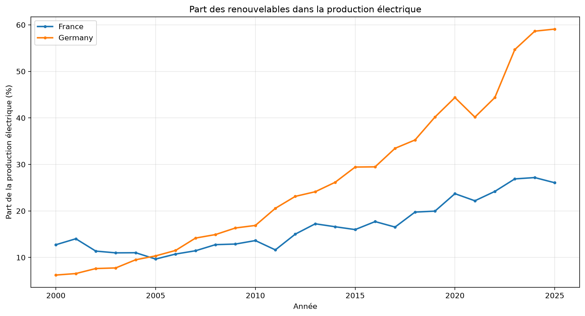

# Energy Data Engineering Lab

## Objectif

Construire progressivement une plateforme de traitement
et d'analyse de données énergétiques publiques.

## Premier cas métier

Comment a évolué la part des renouvelables
dans la production d'électricité en France
et en Allemagne entre 2000 et 2025 ?

## Source

Our World in Data - Energy Dataset
Version : 2026-09-10

https://catalog.ourworldindata.org/energy/owid_energy/

Les données sont compilées à partir de plusieurs producteurs,
notamment Ember et Energy Institute. Consulter les conditions
de réutilisation et les références sur le site source.

## Technologies

- Python
- pandas
- Git et GitHub
- pytest (prochain module)

## Installation

python3 -m venv .venv
source .venv/bin/activate
python -m pip install -r requirements.txt

## Données

Télécharger le CSV officiel dans data/raw/owid_energy.csv
depuis l'URL de la version 2026-09-10 indiquée ci-dessus.

## Exécution

python src/energy_pipeline.py

## Résultats de l'analyse

### Visualisation

### Données et indicateurs

- [Données transformées](data/processed/renewables_fr_de.csv)
- [Tableau des KPI](reports/kpi_summary.csv)

### Méthodologie

1. Extraction des données énergétiques OWID.
2. Sélection de la France et de l'Allemagne.
3. Filtrage de la période 2000-2025.
4. Traitement des valeurs manquantes.
5. Vérification des doublons et pourcentages.
6. Calcul de l'évolution en points de pourcentage.
7. Export CSV et visualisation.
